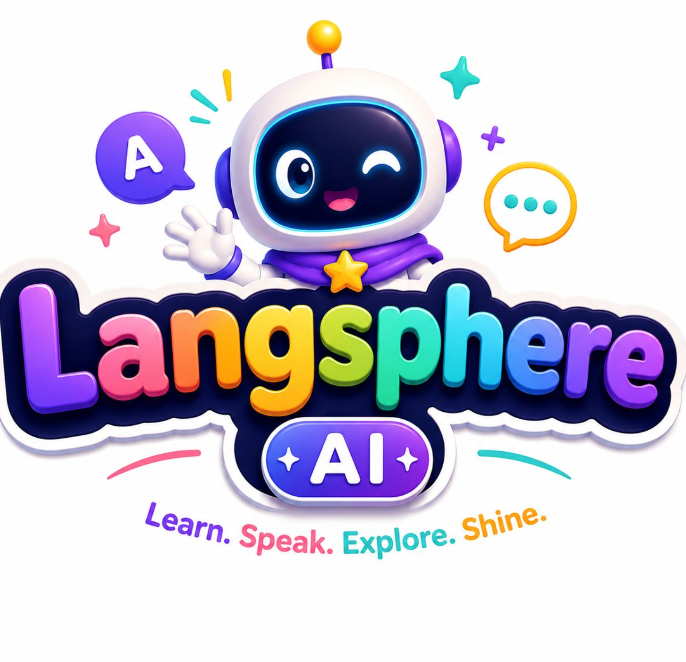

<div align="center">
  

  # Langsphere AI

  **Learn. Speak. Explore. Shine.**

  A gamified, AI-powered app that helps kids learn their heritage language:
  Tamil, Hindi, Telugu, Malayalam and Kannada.

  
  
  
  
</div>

---

## Features

| | Feature | Description |
|---|---|---|
| 🎯 | **Placement test** | Assesses each child and places them in a Beginner, Intermediate or Pro tier. |
| ✍️ | **Writing canvas** | Trace letters and words on screen. AI vision checks the handwriting and gives it a score. |
| 🔤 | **Flashcards & alphabet grid** | Vocabulary practice with native text-to-speech, including Tamil. |
| 🎙️ | **Pronunciation practice** | Record your voice and get feedback on fluency and accent. |
| 🎮 | **Mini-games** | Listen & pick, picture match, pronounce it, and sentence builder, each with levels. |
| 📖 | **Stories & culture** | Translated folk tales with audio narration, festivals, and collectible rewards. |
| 💬 | **AI tutor** | A friendly mascot that chats with the child in the language they're learning. |
| 🏆 | **XP, streaks & leaderboard** | Progress is tracked per language and per level. |
| 👨‍👩‍👧 | **Parent portal** | A separate dashboard where parents can follow XP, streaks and completed modules. |

## Tech stack

- **App:** React Native, Expo SDK 56, Expo Router, TypeScript
- **UI:** NativeWind (Tailwind CSS), Reanimated, Lucide icons, React Three Fiber
- **Auth & data:** Supabase (login), Firebase, MongoDB via an Express API
- **AI:** Google Gemini (content and handwriting evaluation), Groq / Llama 3.1 (tutor chat)
- **Speech:** Expo Speech plus native TTS
- **Hosting:** Render (API), Vercel (web build), EAS (mobile builds)

## Getting started

### Prerequisites

- Node.js 18 or later
- npm
- Android Studio / Xcode for native builds (optional)

### 1. Clone and install

```bash
git clone https://github.com/dineshchandar190297-afk/Deebak-Client.git
cd Deebak-Client
npm install
cd server && npm install && cd ..
```

### 2. Environment variables

Create a `.env` file in the project root:

```env
# Backend API
EXPO_PUBLIC_API_URL=http://localhost:5005
MONGO_URI=your_mongodb_connection_string
SERVER_PORT=5005

# Supabase
EXPO_PUBLIC_SUPABASE_URL=your_supabase_url
EXPO_PUBLIC_SUPABASE_ANON_KEY=your_supabase_anon_key

# Firebase
EXPO_PUBLIC_FIREBASE_API_KEY=your_api_key
EXPO_PUBLIC_FIREBASE_AUTH_DOMAIN=your_auth_domain
EXPO_PUBLIC_FIREBASE_PROJECT_ID=your_project_id
EXPO_PUBLIC_FIREBASE_APP_ID=your_app_id

# AI
EXPO_PUBLIC_GEMINI_API_KEY=your_gemini_api_key
EXPO_PUBLIC_GROQ_API_KEY=your_groq_api_key
```

> Never commit your `.env` file. It is already listed in `.gitignore`.

### 3. Run

```bash
npm run server     # start the backend API
npm run web        # run in the browser
npm run android    # build and run on Android
npm run ios        # build and run on iOS
```

## Scripts

| Command | Description |
|---|---|
| `npm start` | Start the Expo dev server (dev client) |
| `npm run web` | Start the web version |
| `npm run android` / `npm run ios` | Build and run the native app |
| `npm run server` | Start the Express backend |
| `npm run build` | Export a static web build to `dist/` |

## Project structure

```
├── app/                    # Screens (Expo Router)
│   ├── (auth)/             # Login, register, parent login
│   ├── (tabs)/             # Home, games, culture, leaderboard, profile
│   ├── (parent)/           # Parent dashboard
│   ├── practice/[skill]    # Learning modules
│   └── game-*.tsx          # Mini-games
├── components/
│   ├── practice/           # Writing canvas, flashcards, quiz, chat, voice UI
│   ├── culture/            # Stories section
│   └── navigation/         # Sidebar
├── context/                # Auth context
├── utils/                  # AI, speech, Supabase, Firebase, game levels, stories
├── server/                 # Express + MongoDB API
├── assets/                 # Images, fonts, mascot
└── android/                # Native Android project
```

## API endpoints

| Method | Endpoint | Purpose |
|---|---|---|
| POST | `/api/login` | Sign in or create a user |
| POST | `/api/update-profile` | Update name or avatar |
| POST | `/api/update-language` | Set the learning language |
| POST | `/api/update-level` | Set the proficiency tier |
| POST | `/api/update-progress` | Save XP and module progress |
| GET | `/api/leaderboard` | Top learners |
| GET | `/api/community` | Community users |
| GET / POST | `/api/messages` | Community messages |

## Parent portal

From the welcome screen, tap **Parent Portal** and sign in with the student's email and password to see their progress.

---

<div align="center">
  Built with ❤️ by <b>Dinesh</b>
</div>
